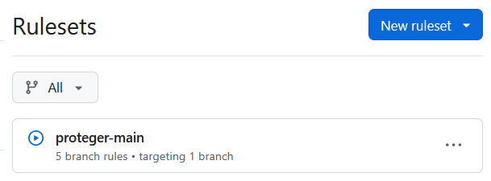

# cicd-pipeline-python

## Integrantes

- Lina Sofia Ballesteros Merchan | Alejandro Rios Muñoz (**Propietario**) | Quinnie Villarreal
- GitHub: [@linaballesteros](https://github.com/linaballesteros) | [@alejoriosm04](https://github.com/alejoriosm04) | [@quinnie9](https://github.com/quinnie9)

## Evidencias

- URL del Pull Request de la sección 9: [Pull Request](https://github.com/alejoriosm04/cicd-pipeline-python/pull/1)
- URL de la ejecución fallida del pipeline causada por el error intencional: [Pipeline](https://github.com/alejoriosm04/cicd-pipeline-python/actions/runs/43633549388/job/132565296458)

### Ruleset

## Preguntas

### ¿Qué ventajas le proporciona a un proyecto el uso de un pipeline de CI? Menciona al menos tres ventajas específicas y explica por qué son importantes.

- **Automatización:** Los pipelines de CI automatizan la ejecución de pruebas, lo que reduce la necesidad de intervención manual y aumenta la velocidad de detección de errores.
- **Integración Continua:** Permite integrar cambios de manera frecuente, lo que facilita la detección de conflictos y la mejora de la calidad del software.
- **Reducción de Riesgos:** Ayuda a identificar problemas temprano, lo que reduce el costo de corrección y aumenta la estabilidad del software.

### ¿Cuál es la diferencia entre una prueba unitaria, una prueba de componente y una prueba de aceptación? Da un ejemplo de algo que probarías con cada una (en el contexto de cualquier aplicación que conozcas, descríbela primero).

Como ejemplo se puede usar una aplicación de pedidos de comida a domicilio. El cliente elige un restaurante, arma un pedido con varias opciones, aplica un cupón, paga y sigue el estado del envío hasta que el repartidor lo entrega. La aplicación está dividida en módulos: catálogo, carrito, pagos y seguimiento.

- **Prueba unitaria:**
  - **Definición:** Comprueba una sola función o método, aislado del resto del sistema. Se le entregan datos de entrada concretos y se verifica el valor que devuelve o el error que lanza. No usa base de datos, red, pantalla ni otros módulos, si la función necesita algo externo, ese dato se pasa como argumento. Son rápidas y señalan con precisión qué cálculo o validación se rompió.
  - **Ejemplo:** La función `calcular_total(platos, domicilio, cupon)` suma los precios, agrega el domicilio y resta el descuento. Una prueba llama `calcular_total([12000, 8000], 3000, 5000)` y espera `18000`. Otra llama la misma función con un cupón mayor que el subtotal y espera que el total no baje de cero. Si el resultado cambia, el fallo está en esa función y en ninguna otra.

- **Prueba de componente:**
  - **Definición:** Comprueba un módulo completo y la forma en que sus partes colaboran, con las dependencias externas reemplazadas por sustitutos controlados. El módulo se ejercita a través de su interfaz (por ejemplo, sus métodos públicos o su API), así que se detectan fallos de integración dentro de ese límite: reglas de negocio, validaciones y el contrato con los módulos vecinos. Sigue siendo más acotada que un recorrido de toda la aplicación.
  - **Ejemplo:** Se prueba el módulo del carrito. Se agregan dos opciones de un restaurante, se intenta mezclar una opción de otro restaurante y se aplica un cupón ya vencido. El módulo debe rechazar la opción ajena, rechazar el cupón e informar el motivo, y conservar el total de las opciones válidas. El servicio de pagos se sustituye por un doble que solo registra si fue llamado. Así se verifica el comportamiento del carrito sin cobrar dinero real ni abrir el navegador.

- **Prueba de aceptación:**
  - **Definición:** Comprueba un flujo completo tal como lo usa una persona, sobre la aplicación desplegada (en este proyecto, la imagen Docker en ejecución). Atraviesa la interfaz, el servidor y los servicios necesarios para cumplir un objetivo de negocio. Confirma que el sistema hace lo que el usuario espera, y suele ser más lenta porque levanta el entorno real.
  - **Ejemplo:** Desde el navegador se abre la tienda, se busca "hamburguesa", se agrega una opción al carrito, se escribe una dirección de entrega, se paga con una tarjeta de prueba y se espera la pantalla "Pedido confirmado" con el estado "En preparación". Si el botón de pagar no envía el formulario, si el cupón válido no se aplica o si la confirmación no aparece, la prueba falla aunque cada función suelta haya pasado sus pruebas unitarias.

### Describe brevemente qué hace cada uno de los steps principales de tu workflow de GitHub Actions (desde el checkout hasta el push de Docker). Explica el propósito de cada uno (qué hace y para qué se hace).

- **Checkout:**
  - **Propósito:** Descarga el código del repositorio.
  - **Descripción:** Este paso es crucial para que el pipeline pueda acceder al código fuente del proyecto. Trae además el historial completo, porque SonarCloud lo usa para identificar el código nuevo.

- **Set up Python:**
  - **Propósito:** Configura el entorno de Python para la ejecución de las pruebas.
  - **Descripción:** Este paso instala Python 3.13, la misma versión con la que se construye y ejecuta la aplicación.

- **Install dependencies:**
  - **Propósito:** Instala las librerías que el proyecto necesita para analizarse y probarse.
  - **Descripción:** Este paso instala exactamente las versiones fijadas en `requirements-dev.lock`, solo desde wheels y verificando el hash de cada paquete.

- **Run Black (Formatter):**
  - **Propósito:** Comprueba que el código de `app` respete el formato de Black.
  - **Descripción:** Este paso solo verifica y no modifica archivos. Si el formato no coincide, el pipeline se detiene antes de seguir con el resto de las pruebas.

- **Run Pylint (Linter):**
  - **Propósito:** Analiza el código de `app` en busca de problemas de estilo y calidad.
  - **Descripción:** Este paso guarda el resultado en `pylint-report.txt` para enviarlo después a SonarCloud. No detiene el pipeline por sí solo.

- **Run Flake8 (Linter):**
  - **Propósito:** Revisa el código de `app` con otra herramienta de estilo.
  - **Descripción:** Este paso guarda el resultado en `flake8-report.txt` para que SonarCloud lo incorpore al análisis. Tampoco detiene el pipeline por sí solo.

- **Run Unit and Component Tests:**
  - **Propósito:** Ejecuta las pruebas unitarias y de componente del proyecto.
  - **Descripción:** Este paso verifica que el código funcione correctamente y cumple con los requisitos especificados. Deja fuera las pruebas de aceptación y exige al menos 80 % de cobertura.

- **Build Docker image:**
  - **Propósito:** Construye la imagen Docker del proyecto.
  - **Descripción:** Este paso crea una imagen Docker que encapsula el proyecto y sus dependencias, etiquetada con el commit que se está construyendo.

- **Start container:**
  - **Propósito:** Arranca esa imagen en un contenedor y espera a que la aplicación responda.
  - **Descripción:** Este paso publica el puerto 8000 y consulta la aplicación hasta por 30 segundos, para que las pruebas de aceptación hablen con un servidor ya listo.

- **Run Acceptance Tests:**
  - **Propósito:** Ejecuta las pruebas de aceptación del proyecto.
  - **Descripción:** Este paso verifica que la funcionalidad del proyecto funcione correctamente y cumple con los requisitos especificados. Abre la calculadora en `http://localhost:8000` con Selenium y guarda el informe en `acceptance-report.html`.

- **Show container logs on failure:**
  - **Propósito:** Muestra los logs del contenedor cuando algún paso anterior falló.
  - **Descripción:** Este paso facilita ver por qué la aplicación no respondió o por qué una prueba de aceptación falló. Si todo salió bien, no se ejecuta.

- **Upload Test Reports Artifacts:**
  - **Propósito:** Publica los informes de pruebas, cobertura y linters como artefactos del workflow.
  - **Descripción:** Este paso se ejecuta siempre, también si el pipeline falló, para poder descargar `htmlcov`, los reportes HTML, `coverage.xml` y los informes de Pylint y Flake8.

- **SonarCloud Scan:**
  - **Propósito:** Envía el código y esos informes a SonarCloud.
  - **Descripción:** Este paso analiza la calidad y la cobertura, y espera el resultado del quality gate. Usa el token y la URL configurados en el repositorio.

- **Login to Docker Hub:**
  - **Propósito:** Inicia sesión en Docker Hub.
  - **Descripción:** Este paso solo corre cuando el cambio ya está integrado en `main`. Autentica el pipeline para poder publicar la imagen.

- **Push Docker image:**
  - **Propósito:** Publica la imagen Docker en Docker Hub.
  - **Descripción:** Este paso hace que la imagen esté disponible para otros usuarios y sistemas. También solo corre en `main`: sube la imagen del commit y la etiqueta `latest`.

### ¿Qué problemas o dificultades encontraron al implementar este taller? ¿Cómo los solucionaron? Cada integrante describe al menos un problema o aprendizaje propio, identificándose con su nombre.

- **Quinnie Villarreal:** Aprendí que tener 100% de cobertura no garantiza que el código sea correcto ni seguro. Al cambiar la resta por una suma, cuatro pruebas fallaron aunque la cobertura siguió igual. También vimos que un pipeline verde no significa que no existan hallazgos de seguridad y que las reglas de protección deben estar aplicadas a la rama correcta. El uso de ramas y Pull Requests nos permitió introducir el error, detectarlo y corregirlo antes de integrarlo a main, conservando las ejecuciones como evidencia.

- **Alejandro Rios Muñoz:** Al ejecutar el análisis de SonarCloud dentro de GitHub Actions, el scanner descargaba bien pero el job terminaba con el error de que Automatic Analysis seguía activado. SonarCloud no permite ese análisis automático y el análisis de CI al mismo tiempo. Entré al proyecto como administrador, en **Administration → Analysis Method**, y dejé solo el análisis por CI. Esa vía es la que sube la cobertura, los informes de Pylint y Flake8 y espera el quality gate; el análisis automático no usa esos reportes del pipeline.

- **Lina Sofia Ballesteros:** A mí al principio el pipeline me fallaba y resultó que había olvidado agregar los secretos de Docker y de Sonar, entonces el repo intentaba acceder a SonarCloud y no podía. Encima había creado las variables donde iban los secretos, así que tampoco las encontraba. Yo pensaba que era un error mío de código, porque había ido copiando archivo por archivo y siguiendo cada instrucción del taller, así que me puse a releer todo con calma a ver qué paso me había saltado y también le preguntaba a la IA qué podía ser; al final caí en cuenta de que era eso: los secretos y variables mal puestos. Después tuve otro problema con Sonar, porque a mí el pipeline me fallaba y a mis compañeros no, aunque ellos tenían más issues que yo. Lo resolví corrigiendo los issues y validando los quality gates hasta que pasó. Lo que me llevo de aprendizaje es lo importante que es conocer estas herramientas que uno puede usar en el día a día como desarrollador, por ejemplo los linters. A mí ya me los habían explicado en algún momento, pero con este taller me quedó claro que vale la pena tenerlos a la mano para corregir esos detalles antes de sacar el código y subirlo. También me quedó la idea de estar revisando constantemente las correcciones que sugiere Sonar, para en otros proyectos tenerlas en cuenta desde el principio y bajar la cantidad de issues.

### ¿Qué ventajas ofrece construir la imagen Docker, ejecutar las pruebas de aceptación sobre ella y publicar exactamente esa misma imagen, en lugar de simplemente validar el código?

Validar solo el código comprueba las funciones en el entorno del runner. La imagen es otro artefacto: el `Dockerfile` elige la base, instala las dependencias fijadas en `requirements.lock`, copia la aplicación y arranca Gunicorn con un usuario que no es root. Un error en cualquiera de esos pasos puede dejar el código verde y la imagen inservible. Por eso el pipeline construye una sola vez la imagen y la etiqueta con el SHA del commit (`$IMAGE_NAME:${{ github.sha }}`). Las pruebas de aceptación no vuelven a ejecutar el código suelto. Levantan esa imagen en el contenedor `calculadora`, esperan a que responda en el puerto 8000 y Selenium recorre la calculadora en `http://localhost:8000`. Así se comprueba el mismo paquete que se publicaría: plantillas, dependencias, puerto y comando de arranque. Si el contenedor no responde o un flujo falla, el job se detiene y los pasos de Docker Hub no se ejecutan.

La publicación reutiliza esa imagen ya probada. En un push a `main`, el pipeline inicia sesión y sube el tag del commit junto con `latest`, sin un segundo `docker build`. Quien descargue la imagen obtiene el artefacto que pasó las pruebas de aceptación, y el tag del SHA permite saber qué commit lo produjo. Un build posterior, hecho en otro momento o con otra resolución de dependencias, podría generar una imagen distinta a la que se validó.

### Sobre el Pull Request de la sección 9: ¿qué pruebas agregaron y qué error de la calculadora detectaría cada una? Con el error intencional, ¿en qué paso falló el pipeline, qué pasos no se ejecutaron y cómo impidieron la protección de main y el pipeline que ese error llegara a main y a Docker Hub?

El pull request [#1](https://github.com/alejoriosm04/cicd-pipeline-python/pull/1), en la rama `feature/pruebas-adicionales`. `test_restar_decimales` comprueba que `restar(0.3, 0.1)` sea aproximadamente `0.2`: detecta una resta que falle con decimales, incluida la que suma los operandos en lugar de restarlos. `test_restar_dos_negativos` comprueba que `restar(-5, -2)` sea `-3`: detecta un error de signo al restar dos negativos, porque `-5 - (-2)` da `-3` y una suma daría `-7`.

El error intencional reemplazó `return a - b` por `return a + b` en `restar`. En la [ejecución del pull request](https://github.com/alejoriosm04/cicd-pipeline-python/actions/runs/43633549388/job/132565296458) el paso **Run Unit and Component Tests** falló. Pytest marcó cuatro pruebas: las dos nuevas, `test_restar` (esperaba `3` y obtuvo `7`, porque `5 + 2`) y `test_index_post_restar` (el formulario con 5 y 3 mostró `Resultado: 8.0`).

Ese fallo detuvo el resto del trabajo de construcción y publicación. No se ejecutaron **Build Docker image**, **Start container**, **Run Acceptance Tests**, **SonarCloud Scan**, **Login to Docker Hub** ni **Push Docker image**. Sí se ejecutaron **Show container logs on failure** y **Upload Test Reports Artifacts**.

El ruleset `proteger-main` aplica sobre la rama por defecto. Exige un pull request con una aprobación y el check `build-and-test`, y bloquea el push directo, el force push y borrar `main`. Con ese check en rojo, GitHub no permitía integrar el cambio. La publicación a Docker Hub, además, solo ocurre en un push a `main` y después de las pruebas. El error se quedó en la rama del pull request, un commit posterior devolvió `return a - b` y no llegó a `main` ni a Docker Hub.